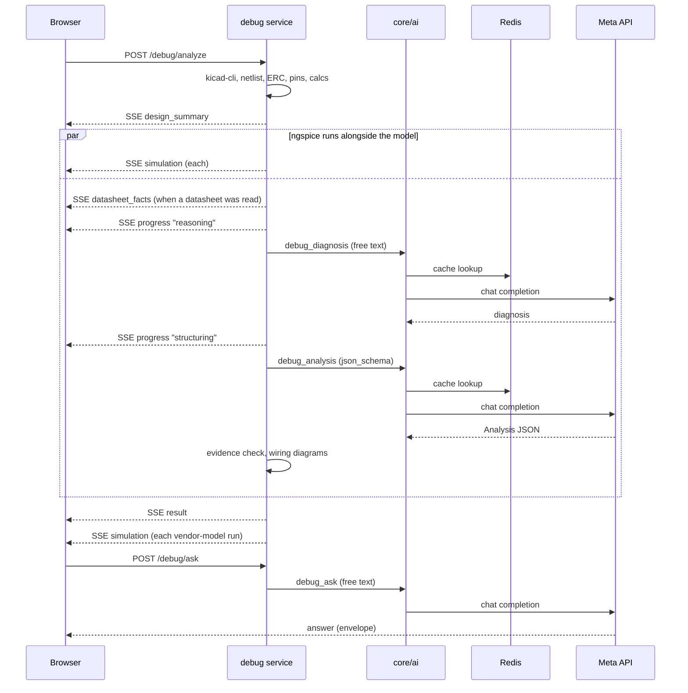

# Häxrök

*Hunt down the fault before the magic smoke escapes.*

Häxrök is a schematic debugger. You give it your
KiCad netlist and describe the symptom you see on the bench. It ranks root-cause
hypotheses and labels every claim with what it rests on: your netlist, KiCad's
ERC, the part's datasheet pins, the manufacturer's reference design, a value
calculated from your resistors, or nothing. Before you order boards, the same
pipeline runs as a **pre-fab review**: no symptoms, just the design mistakes a
reviewer would flag.

Most AI schematic tools are linters that run before fab. Häxrök works the other
way round, starting from a board that already misbehaves.

Built for the Meta Global AI Developer Hackathon (2026).

## Status

The MVP is built: a KiCad project folder runs end to end from the UI,
and it ranked a real board's fault #1. Pre-fab review mode, reference
designs, wiring checks and ngspice simulations are built too.

Scope, the go/no-go result and the ideas weighed against this one are in
[`docs/plans/001-100/001-mvp-scope.md`](docs/plans/001-100/001-mvp-scope.md).

- [x] Eval harness and planted-fault cases (`evals/`)
- [x] Go/no-go: does the model find the bug? On a real bug (a private
      board, not in the repo) it found it #1 from the netlist alone, so
      it's a go (`docs/plans/001-100/001-mvp-scope.md`)
- [x] MVP debug feature: KiCad project folder drop (netlist and ERC are
      extracted by the backend), symptom box, pin-function
      lookup, ranked hypotheses with source labels
- [x] Pin-table wiring check before the model, a rule-based confidence
      label per hypothesis, and a small wiring diagram per hypothesis
- [x] Pre-fab review mode: no symptoms, issues ranked by severity
      (won't work / may fail / improvement), "no issues" allowed
- [x] Reference designs: notes from the manufacturers' own documents for a
      few ICs, and values calculated from the netlist with datasheet
      formulas (regulator output from its feedback divider, charger
      current), flagged when they contradict the design
- [x] Wiring checks in code: USB-C CC pull-downs, missing decoupling,
      SOT-23 transistor pinouts, and from
      `docs/plans/001-100/002-verified-wiring-checks.md` UART wired TX to
      TX, a regulator enabled from its own output, an STM32 BOOT0 that
      can never be low, and pull-ups above an IC's supply
- [x] ngspice simulations of I²C lines and enable/reset RC delays, run in
      parallel with the review and drawn as waveforms. You can ask the model
      about each one (`docs/plans/001-100/003-simulate-and-ask.md`)
- [x] Datasheets: each IC's PDF is fetched from the schematic's URL or
      LCSC, read once per part by the model, and its pins, limits and
      typical application are cited by page. The board is checked against
      each typical application in code: a missing required part, a value
      outside the datasheet's range, a tied pin left open, an inductor whose
      value field disagrees with its part number. Regulators whose vendor
      SPICE model loads in ngspice are then simulated (start-up, load step
      or dropout, ticked per run) and flagged against the datasheet's
      limits. The page shows each IC's datasheet and model, and under each
      claim the facts it cites, linked to their page
      (`docs/plans/001-100/004-datasheets-and-simulation.md`)
- [ ] Stretch: agent loop, what-if re-runs ("try C5 = 1 µF")

The app started from a FastAPI, React and Postgres template. Its seed chat,
voice and image features and its database have been removed; `debug` is the
only feature.

## Quick start

```sh
make dev        # generates .env, starts shared infra (Redis),
                # then starts backend + frontend
```

Then open the printed frontend port (default http://localhost:5173).

### Model API

All model calls go to Meta's OpenAI-compatible API. Set these in `.env`:

```
AI_BASE_URL=https://api.meta.ai/v1
AI_API_KEY=<Meta API key>
AI_CHAT_MODEL=muse-spark-1.3-contributor
```

Any other OpenAI-compatible endpoint (a gateway such as LiteLLM or Bifrost,
or another provider) works by changing these variables. No code changes are
needed.

### How the app uses the model

Every model call is a chat completion with `AI_CHAT_MODEL` (Meta's
`muse-spark-1.3-contributor`, set in `.env`), made through
`backend/app/core/ai/chat.py`. The app asks for no other model: the image,
TTS and STT variables aren't read by any feature, and `AI_CHAT_FALLBACKS`
(a gateway-only option) is empty by default, so every call goes to the Meta
model.

- **Analyze** (`POST /api/v1/debug/analyze`, debug or review mode): two calls
  in a row.
  1. `debug_diagnosis`: free text. The model traces the circuit (or reviews
     it, in review mode) and writes its reasoning in English.
  2. `debug_analysis`: structured output. It turns that diagnosis into
     `Analysis[Claim]` JSON, written in the user's language (en or ja). The
     request asks for a strict `json_schema` and Pydantic validates the
     answer again. `DECISIONS.md` explains why there are two calls.
- **Ask** (`POST /api/v1/debug/ask`): one free-text call (`debug_ask`) per
  question about a simulation.
- **Repeats:** an identical request (same model, fallbacks, messages and
  format) is served from Redis for `AI_CACHE_TTL_S` (7 days) without calling
  the model.

Everything else is our own code, not the model: kicad-cli, netlist and ERC
parsing, the pin-table wiring check, the calculations, ngspice simulations
and the evidence check.



The API streams nothing while the model reasons, so the backend sends
its own `progress` events and these calls use `DEBUG_AI_TIMEOUT_S` (300 s)
instead of `AI_TIMEOUT_S`. Measured on 2026-11-03, one analyze run takes
about 4.5–5 minutes of model time and 55–65k tokens:

- `debug_diagnosis`: ~2 min, ~12k prompt tokens, ~11–12k completion tokens
  (~7–8k of them reasoning).
- `debug_analysis`: 2.5–3.5 min, ~18k prompt tokens, ~18–25k completion
  tokens (~11–17k of them reasoning).

`completion … took …` lines in `logs/backend/app.log` show each call's time
and token usage.

## Evals

```sh
python3 -I evals/gonogo.py --model muse-spark-1.3-contributor
```

`evals/README.md` explains the cases, how to add one and how to read the
results.

## Layout

```
backend/app/
  main.py            # composition root
  core/              # config, db, logging, errors, ai/ (the only place AI is called)
  features/          # one package per feature
frontend/src/
  app/               # shell: routes, index.css
  features/          # index.ts is each feature's public API
  shared/            # ui/, api client, lib/
evals/               # known-bug cases and the go/no-go harness
```

## Commands

`make dev` · `make lint` · `make test` · `make docs` · `make down` · `make purge`

Dependencies: `./scripts/docker/uv.sh add <pkg>` / `./scripts/docker/pnpm.sh add <pkg>`
(they run inside the containers, against the pinned lockfiles).
